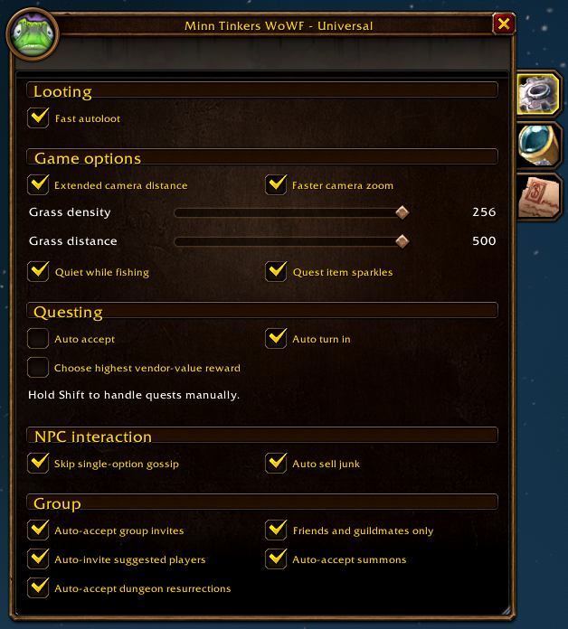
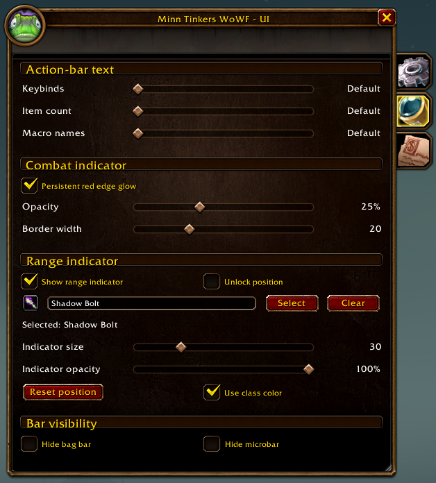
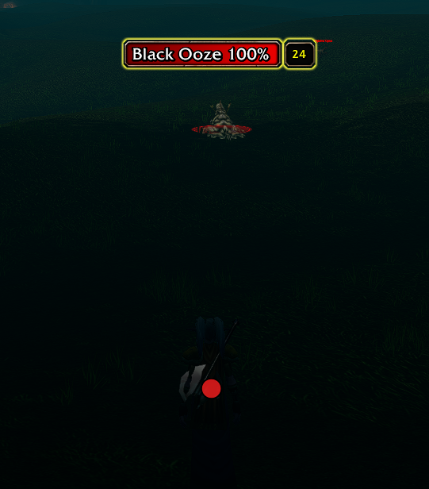
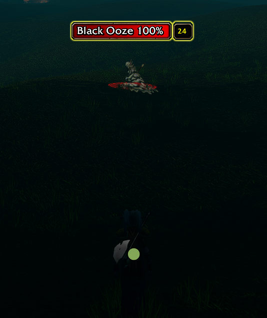
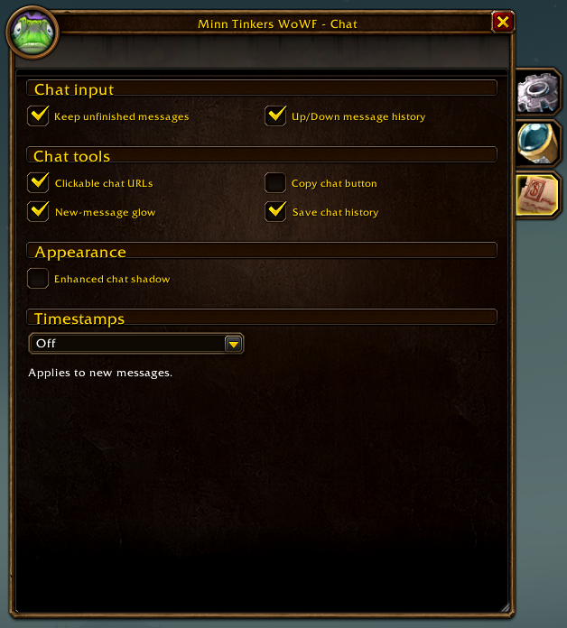

[**Download the latest ZIP**](https://github.com/Minnona/Minn-Tinkers-WoWF/releases/latest/download/Minn-Tinkers-WoWF.zip)

# Minn Tinkers WoWF

Quality-of-life settings for **World of Warcraft: Forever**.

Extract the ZIP into `Interface/AddOns/`, keeping the folder named `Minn Tinkers WoWF`. Open settings with **`/minn`** or the frog minimap button.

## Universal

- **Fast autoloot** skips the loot window when Auto Loot is on.
- **Extended camera distance** raises the zoom limit to 4.0.
- **Faster camera zoom** moves the camera 50% farther per mouse wheel notch.
- **Grass density and distance** let you add more grass and see it farther away.
- **Quiet while fishing** fades out music and ambience and raises effects to 100%. Your usual mix comes back after you stop.
- **Quest item sparkles** highlights eligible objects when Outline Mode is off.
- **Questing** accepts and turns in quests for you. Quests with multiple reward choices wait for you to turn them in. The addon can suggest the reward that sells for the most. Hold **Shift** to handle quests manually.
- **Gossip** picks the only dialogue option when the NPC has no quests listed.
- **Junk selling** sells grey items when you open a vendor. Hold **Shift** to skip it.
- **Group** can handle invites, invite suggestions, summons, and regular dungeon rezzes. Battle rezzes stay manual.

## UI

- Set separate sizes for **keybinds**, **item counts**, and **macro names** on the action bar.
- **Combat indicator** adds a red glow around the screen while you're in combat.
- **Bags and bars** lets you hide the bag bar, microbar, or locked 2FA backpack slots.
- **Range indicator** shows a movable dot that turns red when your target is out of range of your chosen spell. In range, it uses white or your class color.

Range indicator examples using the hunter class color:

| Out of range (red) | In range (class color) |
| --- | --- |
|  |  |

## Chat

- **Chat input** keeps your draft when you press Esc. Use Up and Down to recall recent messages. Type commands like `/target` directly.
- With **Chat URLs**, click a link like `discord.gg/invite` and press **Ctrl+C** to copy it.
- **Copy chat** adds a button beside the chat input to open a copy window.
- **New-message glow** pulses in your class color when messages arrive while you're scrolled up.
- **Enhanced chat shadow** adds a little more shadow to chat text.
- **Disable chat censoring** turns off both built-in chat filters.
- **Save chat history** keeps recent chat after a reload or logout.
- Use **Timestamps** to choose how the time appears on new messages.

## Hunter

Shown only for hunters.

- **Pet happiness bar** shows how much happiness your pet has, just below its focus bar.
- **Trueshot Aura reminder** gives you a button to recast the buff when it's missing or has a minute left. It stays hidden in combat and on flight paths.

Author: **Minnona (Northdale)**. Licensed under [GPLv3](LICENSE) (GPL-3.0-only).
